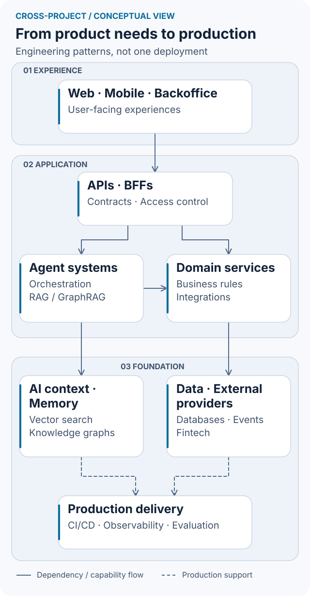

# Gonzalo Martin Perez

### Software Engineer | AI Engineer | Product Engineer

I build production AI systems and the backend, web, and mobile experiences around them—from understanding the user’s problem to deployment and operation. My work connects **applied AI with end-to-end product engineering**: useful interfaces, maintainable architecture, measurable performance, testing, observability, and security.

Currently an **AI Engineer at [Rampy](https://getrampy.com/)**, I work directly with three founders on production AI, fintech, and blockchain features. My experience also spans enterprise integrations at [Teamcubation](https://teamcubation.com/) / Payway and [Cooperativa Obrera](https://www.cooperativaobrera.coop/), institutional software, and independent digital products.

**[Portfolio](https://gonzalomartinperez.com/) · [LinkedIn](https://www.linkedin.com/in/gonzalo-martin-perez/) · [English CV](https://gonzalomartinperez.com/cv) · [CV en español](https://gonzalomartinperez.com/es/cv)**

Bahía Blanca, Argentina · **100% remote (UTC−3)** · Spanish: native · English: professional working proficiency (B2)

## Selected work

- **[Rampy](https://gonzalomartinperez.com/work#rampy)** — Built production AI agents with Neo4j GraphRAG: optimized flows achieved **at least 2× faster response times, verified through load testing**, while removing redundant calls reduced token usage by **an estimated 30% in affected queries**. Reduced comparable vault, market, and perpetual query times **from seconds to milliseconds** using parallel calls, prefetching, and Redis caching. Used LangSmith for agent tracing and evaluation.
- **[Teamcubation / Payway](https://gonzalomartinperez.com/work#teamcubation)** — Contributed to event-driven ingestion of **20M+ historical promotions in production** across Python, Java, and Node.js services. Built a merchant-facing GraphRAG assistant with LangSmith tracing and evaluation, plus data-leakage guardrails; worked with PostgreSQL and MongoDB.
- **[Cooperativa Obrera](https://gonzalomartinperez.com/work#cooperativa-obrera)** — Designed and built a permissions backoffice integrating **10+ enterprise systems**, turning a roughly **10-minute manual lookup into an automated workflow taking under 10 seconds**.
- **[Filomena](https://gonzalomartinperez.com/work/filomena)** — Principal author and contributor in a **three-person team** building an exam platform used by **five Argentine national institutions**. Led architecture, backend, frontend, and infrastructure; the project completed my Information Systems Engineering degree at Universidad Nacional del Sur.

## From product needs to production systems

I connect the user experience with the services, AI workflows, and operational tools behind it. This diagram summarizes patterns from my work across different projects; it is not the deployment architecture of a single employer.

<picture>
  <source media="(max-width: 600px) and (prefers-color-scheme: dark)" srcset="assets/product-architecture-compact-dark.svg">
  <source media="(max-width: 600px) and (prefers-color-scheme: light)" srcset="assets/product-architecture-compact-light.svg">
  <source media="(prefers-color-scheme: dark)" srcset="assets/product-architecture-dark.svg">
  
</picture>

Diagram overview and source

Web, mobile, and backoffice connect to APIs and BFFs. APIs route to agent systems and domain services. Agents use vector search and knowledge graphs; domain services connect databases, events, and fintech providers. CI/CD, observability, and evaluations support production delivery. The compact view groups these same capabilities into four layers.

[Full-size light](assets/product-architecture-light.svg) · [Full-size dark](assets/product-architecture-dark.svg) · [Mermaid source](assets/product-architecture.mmd) · [Diagram guide](assets/DIAGRAMS.md)

**Quality throughout the flow:** user-centered design, clear domain boundaries, performance measured on comparable workloads, automated tests, agent evaluations, and security guardrails.

[See the project-specific architectures and outcomes](https://gonzalomartinperez.com/work)

## Engineering toolkit

A selection from my professional work, projects, and broader hands-on experience. [Explore the full stack and its project evidence](https://gonzalomartinperez.com/stack)

**AI & agents**

      

**Languages & backend**

        

**Web & mobile**

    

**Data**

   

**Cloud, delivery & observability**

       

**Application delivery & reverse proxies**

   

**Applied AI:** Generative AI and LLMs; RAG / GraphRAG; context and prompt engineering; embeddings, chunking, and reranking; AI testing, LangSmith tracing and evaluation, and guardrails; fine-tuning and LLMOps. I work with OpenAI API, Claude API, Agno, and pgvector alongside the tools above.

**Experience scope:** Solidity reflects limited hands-on work at Rampy. Infrastructure work includes DigitalOcean deployments; AWS and Kubernetes experience centers on application development, integration, and diagnosis.

**Production engineering:** Hexagonal, layered, and event-driven architecture; REST APIs and BFFs; design systems; SQL tuning; AWS Lambda, S3, SQS, and API Gateway; CI/CD, access control, and end-to-end encryption. My broader infrastructure experience includes Coolify for deployments and knowledge of NGINX, Traefik, and Caddy for web serving and reverse proxying.

**Fintech integrations:** Morpho, Aave, Compound, Hyperliquid, LI.FI, Privy, and Stripe—across product interfaces, backend services, wallets, and transaction flows.

## Let’s build something useful

I’m open to **100% remote software, AI, and product engineering opportunities**, including backend and full-stack roles, and available for interviews.

[Get in touch](https://gonzalomartinperez.com/contact) · [Browse my experience](https://gonzalomartinperez.com/work) · [Portfolio en español](https://gonzalomartinperez.com/es/)
