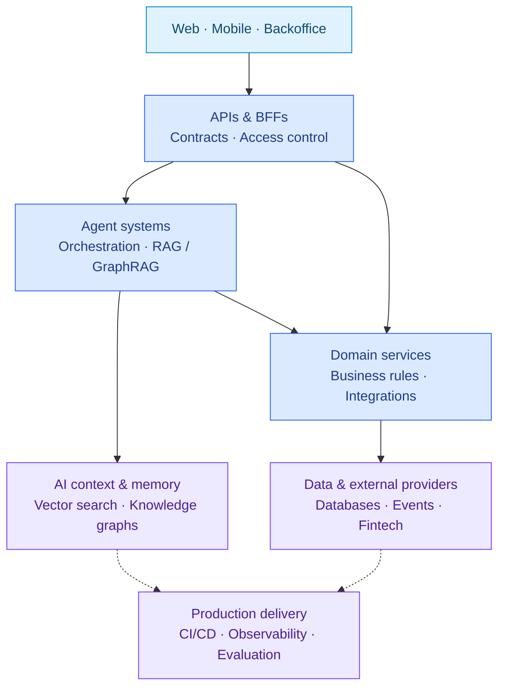

# Gonzalo Martin Perez

### Software Engineer | AI Engineer | Product Engineer

I build AI agents, distributed backends, and web and mobile products—from understanding the problem to shipping and operating the solution. My work connects **applied AI with end-to-end product engineering**: useful interfaces, maintainable architecture, measurable performance, testing, observability, and security.

Currently an **AI Engineer at [Rampy](https://getrampy.com/)**, I work directly with three founders on production AI, fintech, and blockchain features. My experience also spans enterprise integrations at [Teamcubation](https://teamcubation.com/) / Payway and [Cooperativa Obrera](https://www.cooperativaobrera.coop/), institutional software, and independent digital products.

**[Portfolio](https://gonzalomartinperez.com/) · [LinkedIn](https://www.linkedin.com/in/gonzalo-martin-perez/) · [English CV](https://gonzalomartinperez.com/cv) · [CV en español](https://gonzalomartinperez.com/es/cv)**

Bahía Blanca, Argentina · **100% remote (UTC−3)** · Spanish: native · English: professional working proficiency (B2)

## Selected work

- **[Rampy](https://gonzalomartinperez.com/work#rampy)** — Built production AI agents with Neo4j GraphRAG: optimized flows ran **at least 2× faster by my estimate**, while removing redundant calls reduced token usage by **an estimated 30% in affected queries**. Reduced comparable vault, market, and perpetual query times **from seconds to milliseconds** using parallel calls, prefetching, and Redis caching.
- **[Teamcubation / Payway](https://gonzalomartinperez.com/work#teamcubation)** — Contributed to event-driven ingestion of **20M+ historical promotions in production** across Python, Java, and Node.js services. Built a merchant-facing GraphRAG assistant with evaluation and data-leakage guardrails; worked with PostgreSQL and MongoDB.
- **[Cooperativa Obrera](https://gonzalomartinperez.com/work#cooperativa-obrera)** — Designed and built a permissions backoffice integrating **10+ enterprise systems**, turning a roughly **10-minute manual lookup into an automated workflow taking under 10 seconds**.
- **[Filomena](https://gonzalomartinperez.com/work/filomena)** — Principal author and contributor in a **three-person team** building an exam platform used by **five Argentine national institutions**. Led architecture, backend, frontend, and infrastructure; the project completed my Information Systems Engineering degree at Universidad Nacional del Sur.

## From product needs to production systems

I connect the user experience with the services, AI workflows, and operational tools behind it. This diagram summarizes patterns from my work across different projects; it is not the deployment architecture of a single employer.

**Quality throughout the flow:** user-centered design, clear domain boundaries, performance measured on comparable workloads, automated tests, agent evaluations, and security guardrails.

[See the project-specific architectures and outcomes](https://gonzalomartinperez.com/work)

## Engineering toolkit

A selection from my professional work, projects, and broader hands-on experience. [Explore the full stack and its project evidence](https://gonzalomartinperez.com/stack)

**AI & agents**

     

**Languages & backend**

        

**Web & mobile**

    

**Data**

    

**Cloud, delivery & observability**

        

**Applied AI:** Generative AI and LLMs; RAG / GraphRAG; context and prompt engineering; embeddings and chunking; AI testing, evaluation, and guardrails; fine-tuning and LLMOps. I work with OpenAI API, Claude API, Agno, and pgvector alongside the tools above.

**Experience scope:** Solidity reflects limited hands-on work at Rampy. Infrastructure work includes DigitalOcean deployments; AWS and Kubernetes experience centers on application development, integration, and diagnosis.

**Production engineering:** Hexagonal, layered, and event-driven architecture; REST APIs and BFFs; design systems; SQL tuning; AWS Lambda, S3, SQS, and API Gateway; CI/CD, access control, and end-to-end encryption. My broader infrastructure experience also includes Coolify and reverse proxies.

**Fintech integrations:** Morpho, Aave, Compound, Hyperliquid, LI.FI, Privy, and Stripe—across product interfaces, backend services, wallets, and transaction flows.

## Let’s build something useful

I’m open to **100% remote software, AI, and product engineering opportunities**, including backend and full-stack roles, and available for interviews.

[Get in touch](https://gonzalomartinperez.com/contact) · [Browse my experience](https://gonzalomartinperez.com/work) · [Portfolio en español](https://gonzalomartinperez.com/es/)
