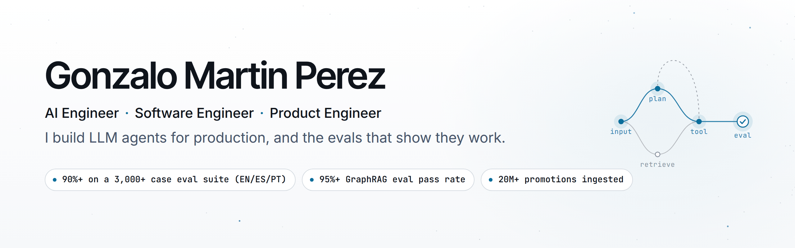

<picture>
  <source media="(prefers-color-scheme: dark)" srcset="assets/hero/github-hero-dark.png">
  
</picture>

I build LLM agents for production, and the evals that show they work. Right now I'm the only engineer at [Rampy](https://getrampy.com/), an early-stage US fintech, where I own the multilingual AI assistant and the product around it: agents, evals, backend, web and the React Native app.

**[Portfolio](https://gonzalomartinperez.com/) · [LinkedIn](https://www.linkedin.com/in/gonzalo-martin-perez/) · [CV (EN)](https://gonzalomartinperez.com/cv) · [CV (ES)](https://gonzalomartinperez.com/es/cv) · [Email](mailto:gonzalomartinperez2002@gmail.com)**

Remote from Bahía Blanca, Argentina (UTC-3) · Spanish (native) · English (professional working proficiency)

## Selected work

- **[Rampy](https://gonzalomartinperez.com/work#rampy)** · AI Engineer, 2026–present. A multilingual assistant (English, Spanish, Portuguese) on a multi-agent LangGraph graph with Claude, gated by an eval suite of 1,000+ scenarios replicated in three languages and graded in LangSmith by a human-validated LLM-as-a-judge. The agents pass **90%+**, and respond **2× faster with 40% fewer tokens**. Answers render as native UI in the app, and users confirm every transaction in their own wallet. Around the agents: trading across **200+ Hyperliquid markets**, swaps across **100+ tokens**, yield vaults and the company's fee model.
- **[Payway, via Teamcubation](https://gonzalomartinperez.com/work#teamcubation)** · Software Engineer, 2025–2026. A GraphRAG assistant for a merchant platform serving 350,000+ merchants in 13 countries: **95%+ on a 500+ case eval suite**, with guardrails against off-topic questions and data leaks. Event-driven ingestion of **20M+ promotions** into production.
- **[Cooperativa Obrera](https://gonzalomartinperez.com/work#cooperativa-obrera)** · Software Engineer, 2024–2025. A permissions back office connecting **10+ internal systems**; a 10-minute manual lookup now takes under 10 seconds.
- **[Filomena](https://gonzalomartinperez.com/work/filomena)** · Capstone project, 2025. An exam platform used in production by **five national institutions in Argentina**, with 1,000+ concurrent users. Graded 10/10.

## Public code

- **[portfolio-assistant-api](https://github.com/gonzalomartinperez/portfolio-assistant-api)** · The assistant behind my portfolio: FastAPI and LangGraph, hybrid retrieval with GraphRAG, cited answers streamed over SSE and cost limits. Evaluated with a 1,000-question bilingual bank, adversarial cases and 800+ tests. Implemented and evaluated; not deployed yet.
- **[pequeverso-assistant-api](https://github.com/gonzalomartinperez/pequeverso-assistant-api)** · A commercial GraphRAG shopping assistant grounded in a store catalog, with server-validated prices and links.
- **[portfolio](https://github.com/gonzalomartinperez/portfolio)** · My bilingual Next.js site, with an enforced architecture boundary check.
- **[filomena-backend](https://github.com/gonzalomartinperez/filomena-backend) / [filomena-frontend](https://github.com/gonzalomartinperez/filomena-frontend)** · The production Laravel API and Next.js front end of Filomena.

## How I build AI products

Good software engineering is what turns an AI demo into a product people can trust. That shapes how I work:

1. **Evals first.** Nothing ships until it passes the eval suite, however good the demo looks.
2. **Grounded answers.** Retrieval and tools over guesses, and a clear "no" for questions outside the product's scope.
3. **Latency and cost are product metrics.** Tokens and response time get tracked like any other regression.
4. **The agent is one part of the product.** The API, the UI contract and the operations around it matter just as much.

<picture>
  <source media="(max-width: 600px) and (prefers-color-scheme: dark)" srcset="assets/product-architecture-compact-dark.svg">
  <source media="(max-width: 600px) and (prefers-color-scheme: light)" srcset="assets/product-architecture-compact-light.svg">
  <source media="(prefers-color-scheme: dark)" srcset="assets/product-architecture-dark.svg">
  
</picture>

Diagram overview and source

Web, mobile, and backoffice connect to APIs and BFFs. APIs route to agent systems and domain services. Agents use vector search and knowledge graphs; domain services connect databases, events, and fintech providers. CI/CD, observability, and evaluations support production delivery. The compact view groups these same capabilities into four layers.

[Full-size light](assets/product-architecture-light.svg) · [Full-size dark](assets/product-architecture-dark.svg) · [Mermaid source](assets/product-architecture.mmd) · [Diagram guide](assets/DIAGRAMS.md)

## Toolkit

**AI:** LangGraph · LangChain · LangSmith · Claude API · OpenAI API · MCP · RAG and GraphRAG · Neo4j · pgvector\
**Backend:** Python · FastAPI · TypeScript · Node.js · NestJS · Java · Spring Boot\
**Frontend and mobile:** React · Next.js · React Native\
**Data and infrastructure:** PostgreSQL · Redis · AWS · Docker · Kubernetes · GitHub Actions · OpenTelemetry

Open to AI Engineer roles, and to software and product engineering roles, fully remote. [Get in touch](https://gonzalomartinperez.com/contact).
